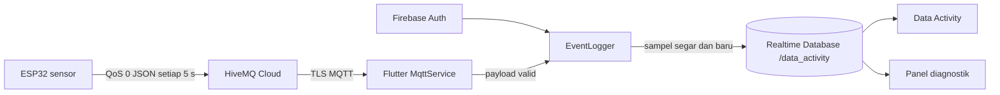

# Alur Data MQTT ke Firebase

ESP32 tidak menulis ke Firebase. Flutter menjadi subscriber sekaligus client
yang menulis ke `/data_activity`; penulisan otomatis berjalan selama aplikasi
hidup, pengguna Firebase login, broker tersambung, subscription di-ACK, dan
data sensor belum stale.

`EventLogger` dibuat saat startup melalui Provider `lazy: false`. Saat Auth
berubah, logger memuat role, mengelola satu koneksi MQTT, dan memutus sesi pada
logout/perubahan UID. Navigasi ke Data Activity tidak memulai atau memutus MQTT.

Snapshot diperiksa tiap 10 detik. Snapshot dilewati bila data stale (batas awal
15 detik), subscription belum siap, atau fingerprint sampel sama dengan sampel
terakhir yang sukses ditulis. `timestamp` adalah waktu server Firebase,
`received_at` waktu lokal Flutter, dan `device_ts_ms` adalah uptime `millis()`
ESP32, bukan waktu kalender.

Penyimpanan tidak berlangsung ketika proses aplikasi ditutup. Untuk rekaman
kontinu diperlukan backend MQTT-to-Firebase yang berjalan di hosting; rancangan
tahap berikutnya dijelaskan pada `FIREBASE_TROUBLESHOOTING.md`.